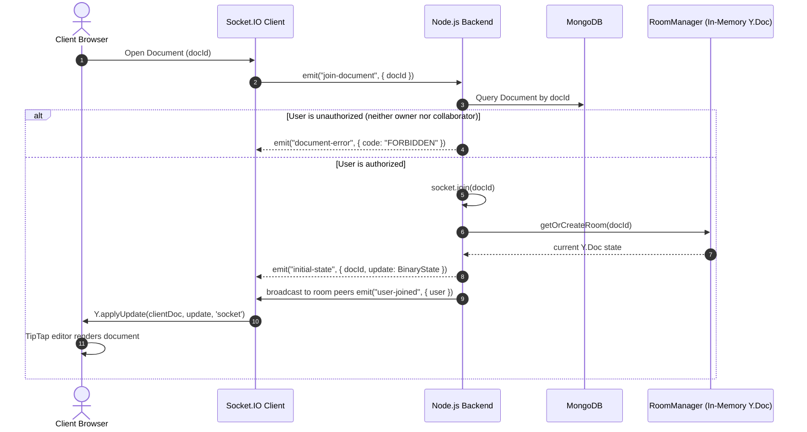

# CollabSync Architecture Specification (Phase 1)

## 1. System Overview

**CollabSync** is a real-time collaborative document editor engineered with Conflict-free Replicated Data Types (CRDTs). The Phase 1 foundation establishes secure user authentication, document access control, and in-memory real-time collaborative editing using TipTap, Yjs, and Socket.IO.

```
┌─────────────────────────────────────────────────────────────────────────────┐
│                             SYSTEM ARCHITECTURE                             │
│                                                                             │
│   ┌───────────────────────────┐         ┌───────────────────────────┐       │
│   │   Browser Session A       │         │   Browser Session B       │       │
│   │   React 18 + TipTap       │         │   React 18 + TipTap       │       │
│   │   Y.Doc (Local CRDT)      │         │   Y.Doc (Local CRDT)      │       │
│   └─────────────┬─────────────┘         └─────────────┬─────────────┘       │
│                 │ Binary CRDT                         │ Binary CRDT         │
│                 │ Updates                             │ Updates             │
│                 ▼                                     ▼                     │
│   ┌─────────────────────────────────────────────────────────────────┐       │
│   │                       Node.js + Express                         │       │
│   │                Socket.IO Transport & Room Router                │       │
│   │                                                                 │       │
│   │    ┌───────────────────────────────────────────────────────┐    │       │
│   │    │            RoomManager (Active Sessions)              │    │       │
│   │    │  docId -> { ydoc: Y.Doc, activeSockets: Set<id> }     │    │       │
│   │    └───────────────────────────────────────────────────────┘    │       │
│   │                                                                 │       │
│   │    ┌──────────────────┐               ┌───────────────────┐     │       │
│   │    │ Auth Middleware  │               │ Document RBAC     │     │       │
│   │    │ JWT Verification │               │ Owner / Collabs   │     │       │
│   │    └─────────┬────────┘               └─────────┬─────────┘     │       │
│   └──────────────┼──────────────────────────────────┼───────────────┘       │
│                  │                                  │                       │
│                  ▼                                  ▼                       │
│   ┌─────────────────────────────────────────────────────────────────┐       │
│   │                         MongoDB 7.0                             │       │
│   │   • Users (email, name, passwordHash)                           │       │
│   │   • Documents Metadata (title, ownerId, collaboratorIds)        │       │
│   └─────────────────────────────────────────────────────────────────┘       │
└─────────────────────────────────────────────────────────────────────────────┘
```

---

## 2. Responsibility Boundaries

A central tenet of the CollabSync design is the strict separation of concerns:

| Layer | Responsibility | What It Does NOT Do |
| :--- | :--- | :--- |
| **TipTap (ProseMirror)** | Rich-text UI, DOM event capture, caret rendering. | Does not resolve concurrent edit conflicts or manage network sockets. |
| **Yjs (`Y.Doc`)** | CRDT state, mathematical convergence, delta encoding, causality tracking. | Does not transport network packets, enforce user permissions, or query databases. |
| **Socket.IO** | Bi-directional WebSocket/polling transport, connection recovery, room partitioning. | Does not resolve document conflicts or reorder text edits. |
| **Express Application Server** | Authentication (JWT), document authorization, room admission, user identity. | Does not transform keystrokes. |
| **MongoDB** | Durable storage for users and document metadata in Phase 1. | Does not store ephemeral cursor positions or keystroke streams. |

---

## 3. Data Flow & Synchronization Mechanics

### 3.1 Initial Document Join Flow



### 3.2 Real-Time Concurrent Mutation Flow

1. **Local Edit:** User types in TipTap. TipTap dispatches a ProseMirror transaction to the local `Y.Doc`.
2. **CRDT Update Generation:** `ydoc.on('update', (update, origin) => { ... })` fires with the binary delta.
3. **Loop Prevention:** The listener inspects `origin`. If `origin === 'socket'`, the update was caused by a remote peer and is **not** re-emitted. If `origin !== 'socket'`, it was typed locally and is emitted:
   ```typescript
   socket.emit('document-update', { docId, update: Array.from(update) });
   ```
4. **Server Relay:** 
   - The server verifies `socket.rooms.has(docId)`.
   - The server applies the update to its in-memory room `Y.Doc` (`Y.applyUpdate(room.ydoc, update, socket.id)`).
   - The server broadcasts to all *other* sockets in the room:
     ```typescript
     socket.to(docId).emit('document-update', { docId, update });
     ```
5. **Peer Convergence:** Receiving peers apply the binary update with origin `'socket'`:
   ```typescript
   Y.applyUpdate(clientYDoc, update, 'socket');
   ```
   TipTap reflects the merged changes instantly.

---

## 4. Conflict Resolution & CRDT Guarantees

CollabSync uses Yjs, which implements an optimized tree-based CRDT:
- **Commutative:** Updates can arrive in different orders on different clients (`A + B = B + A`).
- **Associative:** Grouping of updates does not affect convergence (`(A + B) + C = A + (B + C)`).
- **Idempotent:** Applying the same update multiple times is a no-op. Duplicate deliveries over Socket.IO do not corrupt the document.
- **Deterministic:** Every client that receives the same set of updates is mathematically guaranteed to render the exact same text content.

---

## 5. Security & Access Control

1. **Authentication:**
   - Passwords hashed with `bcryptjs` (salt rounds: 10).
   - JWT tokens signed with `JWT_SECRET` containing `{ id, name, email }`.
   - Transported via HTTP-only, SameSite cookies (`collabsync_token`) and supported via `Authorization: Bearer <token>` for API clients.
2. **Document Authorization (RBAC):**
   - Every document has an `owner` (ObjectId) and `collaborators` (Array of ObjectIds).
   - Enforced on every REST route: `GET /api/documents/:id`, `PATCH /api/documents/:id`, `POST /api/documents/:id/collaborators`, `DELETE /api/documents/:id/collaborators/:userId`.
   - Enforced on Socket.IO room join: Sockets attempting to join a room without ownership or collaborator status are rejected with `403 FORBIDDEN` and never added to the socket channel.
3. **Rate Limiting:**
   - 100 requests per 15 minutes on `/api/auth/*` to prevent brute-force attacks.

---

## 6. Forward Compatibility with Phase 2

Phase 1 deliberately restricts document persistence to metadata (`title`, `owner`, `collaborators`). Collaborative editor content is held in memory.

Phase 2 will introduce:
1. **Durable Snapshot Persistence:** Debounced write-behind persisting `Y.encodeStateAsUpdate(ydoc)` to MongoDB `contentBinary` with `{ writeConcern: { w: 'majority' } }`.
2. **Server-Restart Reconstitution:** When initializing a room, `roomManager` will load `contentBinary` from MongoDB before syncing clients.
3. **Two-Step State Vector Resync:** Reconnecting clients will exchange state vectors (`Y.encodeStateVector`) to fetch only missing deltas without replacing existing edits.
4. **Ephemeral Presence:** Live cursor and selection markers broadcast via `y-protocols/awareness` without polluting MongoDB.
